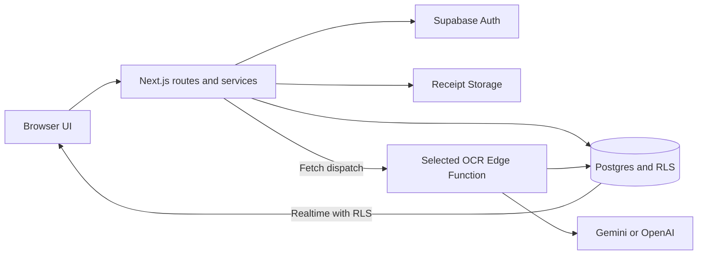

# Architecture Overview

This document describes the runtime boundaries, data flow, security model, and integration points of the Listys Web
App. The canonical placement rules for files and folders live in [`project-structure.md`](./project-structure.md);
this document explains why those boundaries exist and how they interact.

## Product and Platform Summary

Listys is a mobile-first Next.js SaaS for reusable shopping lists, shopping sessions, purchase history, and receipt OCR.
Shared lists and collaborative shopping are experimental and excluded from the MVP, as confirmed on 2026-10-17.
Supabase is the system of record for authentication, relational data, protected receipt storage, and
OCR Edge Functions.

### Runtime stack

- **Web runtime:** Next.js 16 App Router, React 19, and TypeScript.
- **Route boundaries:** `(marketing)` for the public experience and `(authenticated)` for protected application routes.
- **Authentication:** Supabase Auth, exposed through the sign-in, sign-up, and OAuth callback routes under `src/app/auth/`.
  Email/password and Google OAuth are implemented; the password-reset route is incomplete.
- **Persistence:** Supabase Postgres with Row Level Security (RLS). Current server services access Supabase directly; a
  Prisma layer is not part of the current repository structure.
- **File storage:** Supabase Storage for receipt images, protected by user-scoped paths and server-side authorization.
- **Asynchronous processing:** Supabase Edge Functions for the OCR pipeline, with Gemini or OpenAI selected by configuration.
- **UI:** Tailwind CSS v4, shadcn/Radix-compatible primitives, React Hook Form, and Zod.
- **Client-only state:** Zustand for active shopping-session state and other browser state; React providers are kept in
  `src/providers/`.
- **Feedback and interaction:** Sonner for notifications and Framer Motion for selected marketing/auth interactions.
- **Verification:** Vitest in a Node environment and tracked Playwright infrastructure. E2E execution is blocked by
  reset/credential policy gaps; see the [contribution guide](../contributing/CONTRIBUTING.md#playwright-boundary).

## Architectural Boundaries

The application is organized around ownership boundaries rather than technical layers alone:

| Boundary | Location | Responsibility |
| --- | --- | --- |
| Document and route shell | `src/app/` | Root document concerns, route groups, layouts, loading/error states, metadata, and Route Handlers. |
| Public UI | `src/components/marketing/` | Marketing pages and their public shell. It does not receive an authenticated-app mode prop. |
| Authenticated UI shell | `src/components/app/` | Sidebar, header, page containers, active-session UI, and other authenticated structure. |
| Feature UI | `src/components/features/<domain>/` | Domain behavior for auth, base lists, sharing, shopping lists, shopping sessions, tickets, and PWA features. |
| Shared UI | `src/components/commons/` and `src/components/ui/` | `commons/` contains app-owned neutral components; `ui/` contains library primitives and thin wrappers without feature behavior. |
| Server mutations and domain operations | `src/actions/` and `src/lib/server/services/` | Server Actions and API domain services currently have separate implementations; shared schemas/RPCs do not eliminate duplicated business logic. |
| Public HTTP contract | `src/app/api/v1/` | Versioned REST resources and domain actions. Input parsing and shared error envelopes; explicit DTOs, pagination and complete response contracts remain gaps. |
| Platform adapters | `src/lib/supabase/`, `src/lib/api/`, `src/lib/config/`, `src/lib/validations/` | Runtime-specific Supabase clients, HTTP helpers, limits/provider configuration, and Zod schemas. |
| Client state and shared code | `src/stores/`, `src/providers/`, `src/hooks/`, `src/types/`, `src/utils/`, `src/data/` | Browser state, context providers, shared hooks, domain types, pure helpers, and static constants. |

The detailed placement rules are intentionally maintained in one document. When a new top-level responsibility is
introduced, update both documents in the same change.

## Architectural Principles

### Security and integrity

- Authorization is enforced server-side and in Postgres RLS; client visibility is never treated as permission.
- Middleware protects the request path, while `(authenticated)/layout.tsx` re-checks the session as defense in depth.
- API handlers call domain services. Existing Server Actions access Supabase directly and duplicate some service
  behavior; consolidating these paths remains follow-up work.
- Service-role Supabase access remains server-only and is never exposed to browser bundles or response payloads.
- Receipt storage is user-scoped. Queries must preserve owner boundaries or explicitly authorized experimental
  collaborator scope. Service-role operations need application checks because that client bypasses RLS.

### Validation and resiliency

- Route params, query params, request bodies, form data, and external provider responses are untrusted input.
- Zod schemas validate domain JSON input. Multipart upload currently uses manual file checks without applying the
  full upload schema; a schema file does not establish uniform validation.
- Business limits are centralized in `src/lib/config/limits.ts` and reused by UI, services, and API boundaries.
- Mutations expose loading and failure states; OCR failures persist an actionable status/error and support retry.
- API errors use the shared `src/lib/api/http.ts` contract with machine-readable codes and request IDs where applicable.

### Data modeling

- Migrations define lifecycle timestamps and RLS. Timestamp fields vary; not every table has both timestamp columns.
- Foreign-key behavior is explicit: dependent records use `ON DELETE CASCADE`; optional ticket relationships use
  `ON DELETE SET NULL` where the domain permits an orphaned ticket.
- Lifecycle fields use explicit statuses, especially for shopping sessions and OCR processing.
- Constraints and RPCs support integrity. Some orchestration paths perform separate writes; the
  [implementation reference](../reference/implementation-status.md) records concurrency and atomicity gaps.

## HTTP API Policy

### Canonical contract

The public application API is versioned under `/api/v1/...`. New public endpoints must not be added below an unversioned
`/api/` path. The handlers generally use the following response shapes:

- Single resources and successful actions: `{ "data": ... }`.
- Errors: `{ "error": { "code": ..., "message": ..., "details": ..., "request_id": ... } }`.
- Most creates return `201`; upload returns `202`; create-list-from-ticket currently returns `200`. No-body deletes
  return `204`; several dependency failures currently map to `500`.

The [API reference](../reference/api-v1.md) records routes, schemas, statuses and compatibility. Full DTO allowlists,
pagination, OpenAPI/equivalent response schemas, idempotency keys, conditional updates and rate limiting remain gaps.

### Resource and action routing

| Category | Pattern | Current examples |
| --- | --- | --- |
| Resource CRUD | `/api/v1/<resource>` and `/api/v1/<resource>/{id}` | `groups`, `base-lists`, `shopping-sessions`, and `tickets` |
| Nested resources | `/api/v1/<resource>/{id}/<subresource>` | `base-lists/{baseListId}/items`, `shopping-sessions/{sessionId}/items` |
| Filtered reads | Collection query parameters | `/api/v1/shopping-sessions?status=active` |
| Domain actions | `POST /api/v1/<resource>/{id}/<action>` | `complete`, `retry-ocr`, `merge-to-base-list`, `create-base-list` |
| Maintenance actions | `/api/v1/<resource>/maintenance/<action>` | Ticket cleanup and stuck-OCR recovery |

Use resource updates for ordinary attribute changes. Use action endpoints only for domain commands with meaningful
side effects or orchestration. Deprecated routes must advertise `Deprecation`, `Sunset`, and a `Link` successor header.

### Existing compatibility routes

The repository still contains these unversioned handlers:

- `GET /api/health` is an operational health check rather than a product resource.
- `POST /api/upload-ticket` and `GET /api/tickets/{ticketId}/status` are legacy ticket routes.

They are retained for compatibility with existing callers and are not the canonical API surface. New clients and new
features must use `POST /api/v1/tickets` and `GET /api/v1/tickets/{ticketId}/status`. Removing or formally deprecating
the legacy handlers requires a migration note and a defined sunset date.

## Repository Map

This map is the architecture-level view of the structure specified in [`project-structure.md`](./project-structure.md).
That document remains the source of truth for exact placement and component-bucket rules.

```text
src/
├── actions/                 # Server Actions by domain; tests remain in actions/tests/
├── app/
│   ├── (authenticated)/     # Protected routes and authenticated shell boundary
│   ├── (marketing)/         # Public routes and marketing shell boundary
│   ├── api/
│   │   ├── v1/              # Canonical versioned REST resources and actions
│   │   ├── health/          # Operational health check
│   │   ├── tickets/         # Legacy ticket status route
│   │   └── upload-ticket/   # Legacy ticket upload route
│   ├── auth/                # Sign-in, sign-up, and OAuth callback routes
│   ├── error.tsx            # Root error boundary
│   ├── globals.css          # Global styles and design tokens
│   ├── layout.tsx           # Root document layout and providers
│   ├── loading.tsx          # Root loading UI
│   └── manifest.ts          # PWA metadata
├── components/
│   ├── app/                 # Authenticated shell and local shell modules
│   ├── commons/             # Neutral app-owned shared components and icons
│   ├── features/            # Domain UI modules
│   ├── marketing/           # Public shell and landing-page modules
│   └── ui/                  # shadcn/Radix-compatible primitives
├── data/constants/          # Static application constants
├── hooks/                   # Shared hooks promoted from a domain module
├── lib/
│   ├── api/                 # HTTP client, endpoint clients, auth, and helpers
│   ├── config/              # Business limits and OCR/provider configuration
│   ├── server/services/     # Reusable server-side domain operations
│   ├── supabase/            # Client, server, middleware, and admin adapters
│   └── validations/         # Shared Zod and API schemas
├── providers/               # React context providers
├── stores/                  # Zustand stores and their local tests
├── test/                    # Shared Vitest setup and source-inspection guards
├── types/                   # Domain and generated database types
├── utils/                   # Generic helpers and local tests
└── proxy.ts                 # Authentication proxy (middleware) entry point

supabase/
├── config.toml              # Local/project configuration
├── functions/               # OCR Edge Functions
└── migrations/              # Version-controlled SQL schema, RLS, and data-integrity changes

e2e/                          # Versioned Playwright specs and fixtures
```

## Primary Components and Responsibilities

### 1. Next.js route and shell layer

`src/app/` owns URL mapping, route groups, layouts, metadata, loading states, error boundaries, and Route Handlers.
The root layout owns document scope and global providers. Route-group layouts own their respective shells and data
boundaries; the marketing and authenticated shells are deliberately separate.

### 2. Feature and shared UI layer

`src/components/features/` owns domain-specific UI. `src/components/app/` owns authenticated structure and local shell
modules such as active-session, sidebar, app-card, and app-page. `src/components/marketing/` owns the public surface.
`src/components/commons/` is reserved for neutral app-owned reuse, while `src/components/ui/` remains behavior-light.

### 3. Server mutation and service layer

Server Actions in `src/actions/` support server-bound UI flows and query Supabase directly. Route Handlers call the
parallel domain implementations in `src/lib/server/services/`. These paths share schemas and some database RPCs but
are not one consolidated service layer. Do not assume an API fix also updates the equivalent Server Action.

### 4. Versioned API layer

`src/app/api/v1/` exposes the HTTP contract for groups, base lists, shopping sessions, sharing, tickets, and maintenance
operations. `src/lib/api/` provides request parsing, response envelopes, endpoint clients, and API authentication helpers.
Handlers parse inputs before services; several services still return database-shaped results rather than explicit DTOs.

### 5. Supabase platform layer

`src/lib/supabase/` provides runtime-specific clients for browser, server, middleware, and privileged server operations.
Postgres migrations define schema, constraints, triggers, RLS, and realtime-related configuration. Storage contains ticket
images, and Edge Functions run the OCR provider workflow outside the request/response path.

### 6. Client state and synchronization layer

Zustand stores hold browser-only state such as the active shopping session. Feature listeners use Supabase realtime where
needed to reflect session or list-item changes without making the database an unprotected client API.

### 7. Verification layer

Unit/integration tests live with their owning domain module's `tests/` folder or the established local test folder.
Shared setup lives in `src/test/`; Playwright specs live in top-level `e2e/`. Tests must use isolated fixtures and must
not reset or destructively migrate shared Supabase data. Existing E2E broad cleanup violates this boundary and must
be corrected before routine execution.

## Primary Data Flows



The current schema includes owner groups, base lists/items, shopping sessions/items, tickets/items, and (PRD v3 Phase 3)
owner stores with their aliases (every key that resolves to a store; `tickets.store_id` points to a store of the same
user through a composite foreign key) and per-list item aliases (receipt-line names remembered as another name of an
item). An additive follow-on migration defines per-item store statistics, usual-store tags, store-scoped sessions and
`is_other_store`; it is prepared in the repository but has not been applied to a database. Experimental sharing adds
collaborators, invite links and session participants. Migration files describe intended database state;
this audit did not verify a live installation. The PRD ERD is a requirements model; migrations/generated types and
the [implementation reference](../reference/implementation-status.md) qualify what exists.

### Authenticated domain request

1. Middleware refreshes or verifies the Supabase session for the request.
2. The authenticated route layout re-checks access before rendering protected UI.
3. The UI submits through a Server Action or a versioned API client.
4. The boundary parses route/query/body input with the relevant Zod schema.
5. A domain service performs the operation through the appropriate Supabase client.
6. Postgres constraints and RLS enforce ownership, relationships, and concurrency invariants.
7. The handler maps the result into the API envelope, or the Server Action returns a controlled result and revalidates
   the affected route.

### Receipt OCR flow

1. The client submits one to five images to `POST /api/v1/tickets`.
2. The API validates the multipart form, uploads images to the protected `tickets` bucket, and creates a ticket with
   `ocr_status = pending`.
3. A non-awaited fetch dispatch invokes the configured OCR function; no durable queue is established by this code.
   The function marks the ticket `processing`, sends images to the provider (the first image's request also reads the
   store name from the header), deduplicates extracted items, and writes `ticket_items` and, when the ticket has none,
   the raw `store_name`.
4. The function marks the ticket `completed` with `total_items`, or `failed` with `ocr_error`.
5. The UI reads status from `GET /api/v1/tickets/{ticketId}/status` and may invoke `retry-ocr` after a failure.
6. The receipt read proposes the store the raw name resolves to; the user may confirm it, save a new store or choose
   another (`PATCH /api/v1/tickets/{ticketId}` with `store_id`, which also remembers the raw name as an alias).
7. The user chooses whether to merge items into an existing base list or create a new base list through the ticket action
   endpoints. Before merging into an existing list, `GET /api/v1/tickets/{ticketId}/matches` shows how each line matches
   (same name, remembered alias, or new); the user's links travel with the merge, which applies them and remembers them in
   one transaction.

### Shopping-session flow

1. A user starts a session from a base list through the Server Action or `/api/v1/shopping-sessions`, optionally
   selecting one of their stores. At most one active session can belong to a given list; different lists can have
   sessions at the same time.
2. The service clones every base-list item into session items, preserving a snapshot. For a store-scoped session, it
   marks items usual at or previously purchased at that store as `is_other_store = false`; the rest remain available
   with `is_other_store = true`.
3. The UI updates item state through the service/API boundary and receives realtime updates where configured.
4. Completion records status, optional amount and notes, and applies checked items to the base list in the same
   transaction. When store-learning is enabled for that transaction, it increments purchase statistics and recomputes
   each affected item's automatic usual store; a manual usual-store choice is preserved.
5. Completed sessions remain available to the user's history queries.

## Required invariants

These rules must remain true across UI, Server Actions, API handlers, services, and database policies:

1. A caller can only access owned data or the explicitly permitted experimental collaborator scope.
2. A base list has at most one active shopping session; different lists may each have one.
3. Business limits are enforced server-side, including group count, base-list item count, ticket image count, and merge size.
4. OCR status transitions are explicit; failed processing does not appear as completed data and can only be retried through an
   authorized operation.
5. Deleting parents must preserve documented cascade/nullability rules and avoid dangling references/images.
   Current receipt Storage cleanup can fail independently; this requirement is not a verified guarantee.

## Security Model

- Supabase Auth establishes the user identity and session cookies are refreshed through middleware/server clients.
- Protected route layouts and every Server Action/API service require authenticated context before access.
- RLS is the final database authorization boundary, using `auth.uid()` and relationship checks for shared-list access.
- Browser clients use the publishable Supabase key only; privileged operations use the server-only service-role client.
- Zod validation, allowlisted fields, bounded uploads, and centralized limits reduce malformed-input and abuse risk.
- Errors and logs must not expose tokens, credentials, raw provider responses, SQL, or private storage paths.

## Failure Modes and Recovery

| Failure | System behavior | Recovery |
| --- | --- | --- |
| Invalid route/query/body/form data | Reject before service side effects with a validation error. | Correct the client request. |
| Missing/invalid session | Return an authentication failure or redirect protected UI to sign-in. | Re-authenticate and retry. |
| RLS/ownership denial or invisible resource | Treat the resource as unavailable to the caller. | Use an authorized resource or account. |
| Unique/state conflict | Return a conflict and preserve the existing record. | Refresh state and retry with current data. |
| Storage upload failure | Do not report a successfully created OCR ticket; clean up partial artifacts where possible. | Retry the upload. |
| OCR provider/Edge Function failure | Persist `failed` and `ocr_error`; keep the ticket available for retry. | Invoke `POST /api/v1/tickets/{ticketId}/retry-ocr`. |
| Database/dependency outage | Return a controlled server/dependency error and preserve request correlation where available. | Retry only safe/idempotent operations after recovery. |

## Scalability and Evolution

- Next.js Route Handlers and Server Actions remain stateless; durable state belongs in Supabase.
- OCR is asynchronous so provider latency does not hold the upload request open.
- RLS and service boundaries keep ownership checks close to data access as features grow.
- New domain modules should be added under the existing feature/service/type/validation boundaries before creating a new
  top-level bucket.
- New public endpoints stay within the current major version for compatible additions and require a new major version for
  breaking contract changes.
- Frequently changing or unbounded collections must add validated, bounded pagination and deterministic ordering before
  they are exposed to large datasets.

## Related Documents

- [`project-structure.md`](./project-structure.md): exact file/folder placement and component-bucket rules.
- [`AGENTS.md`](../../AGENTS.md): mandatory API, security, validation, testing, and migration policies.
- [`docs/README.md`](../README.md): documentation index and topic ownership.
- [`implementation-status.md`](../reference/implementation-status.md): behavior, experimental scope and remaining gaps.
- [`docs/runbooks/deploy.md`](../runbooks/deploy.md): deployment procedure.
- [`docs/runbooks/incidents.md`](../runbooks/incidents.md): incident response procedure.
