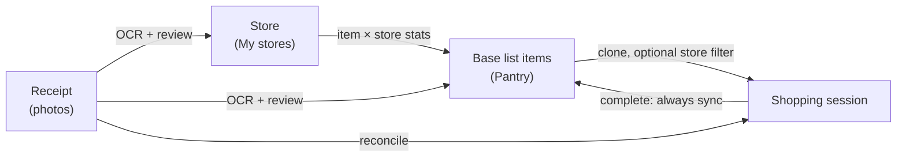

# Listys — Product Requirements Document (v3)

## One Pantry, Many Stores

**Status:** Draft for review — direction approved, phases to be specified in `openspec/` before implementation  
**Supersedes:** the parts of [PRD-v2](PRD-v2.md) listed in §2. Everything in PRD-v2 not listed there still applies.  
**Scope:** Household shoppers on mobile web (PWA). Shared lists remain supported.

---

## 1. Summary

PRD-v2 shipped the core loop: receipt → reviewed items → base list → enriched items → faster shopping sessions.
Using the product since then showed two problems:

1. **The structure asks for decisions the typical user does not need to make.** Groups add a mandatory step
   (choose a group, then a list) to the most important flow — merging a receipt — even though most households
   keep **one** pantry list. Sharing already works per list, so the group does not even represent the household.
2. **The learning is invisible and fragile.** Ordering only improves if the user checks every item *and* turns on
   "sync to base" at the end. Average price is computed but never shown. The store the user shopped at is typed
   by hand as free text and never connected to the items.

The typical user does **not** shop for many purposes. They buy **one pantry, across several supermarkets.** What
varies is not the list but the store.

v3 therefore:

- **Removes groups from the experience** and starts every user with a single "Pantry" list.
- **Makes the store a first-class signal:** extracted from the receipt, normalized into "My stores", and learned
  per item, so a single master list already knows where each thing is usually bought — `Milk · [No Frills]`.
- **Lets a session focus on one store** ("I'm going to No Frills today") while the rest waits for the next stop.
- **Closes the loop with the receipt:** the receipt that ends a trip completes the session, fills the total and real
  prices, and records the store.

---

## 2. What changes from PRD-v2

| Area | PRD-v2 | PRD-v3 |
| --- | --- | --- |
| Structure | Groups contain base lists; group required to create/merge | Flat lists; groups hidden (one implicit default group per user) |
| First run | Empty state; user creates group, then list | A "Pantry" base list exists on sign-up |
| Sync on completion | Optional `sync_to_base` toggle | Always on; no toggle |
| Store | Free-text `store_name`, typed manually, required | Extracted by OCR, matched to a normalized **store**, confirmed in review |
| Item ↔ store | Not modeled | Per-item store statistics + usual-store tag (auto or manual) |
| Session scope | Whole list | Whole list, or filtered to one store |
| Active sessions | One per user | One per base list (see §8, FR-12) |
| Receipt ↔ session | Unrelated flows | Receipt can complete the active/recent session |
| Price memory | `average_price` stored, not shown | Shown as a list-wide average per item; store-specific price comparison is a later product direction, not part of the store-tags-and-scoped-sessions change |
| Terminology | receipt, base list, shopping session, **group**, item | receipt, base list, shopping session, **store**, item |

---

## 3. Problem Statement

A household shopper rebuilds roughly the same pantry list every week or two and spreads it across two or three
supermarkets based on price and habit. Today they must remember which item is cheaper or available where, and a
static list cannot tell them. Listys already has the data to answer this — every receipt names a store and prices
each line — but it discards the store and hides the prices.

---

## 4. Target User & Persona

**Primary persona — the household shopper.** Manages one pantry list for the home, often shared with a partner or
roommates. Shops weekly or every two weeks at 2–3 stores. Uses a phone in the aisle, one-handed, interrupted.

**Needs:**

- "My list should already be there, in the order I shop."
- "Tell me where I usually buy each thing."
- "Today I'm only going to one store — show me what I get there."
- "I don't want to organize anything."

**Secondary persona — the multi-purpose buyer** (small business, second home, office supplies). May keep several
lists. Served by plain multiple lists in v3; dedicated "spaces" are a non-goal (§6).

---

## 5. Product Principles (v3)

1. **One list by default.** The user should never have to design a taxonomy before getting value.
2. **The store is learned, not configured.** Store tags come from receipts and purchases; the user only corrects.
3. **A manual correction is final.** Anything the user sets by hand is never overwritten by learning.
4. **Every completed trip teaches the list.** No toggle decides whether the app learns.
5. **Show the memory.** Frequency, usual store and price become visible, useful facts — never scores or model
   language.
6. Unchanged from v2: nothing is saved from a receipt without review; one hand, interrupted attention; say only what
   is true.

---

## 6. Goals and Non-Goals

**Goals**

1. A new user reaches a usable list and a first session without creating any container.
2. Every base item can show where it is usually bought, learned from receipts and editable.
3. A session can be scoped to one store without splitting the master list.
4. A receipt uploaded after a trip completes that trip with real prices and total.
5. Price memory is visible per item and comparable across stores.

**Non-Goals (v3)**

- "Spaces" or folders (Home / Office / Business) — revisit only if multi-list users ask for them.
- Predictive restock alerts or notifications.
- Store location, maps, or aisle layout per store.
- External price data, flyers, or POS / loyalty integrations.
- Deleting the `groups` table or any existing group data.

---

## 7. Concept Model

- **Base list** — the household's reusable master list (default: "Pantry").
- **Store** — a normalized place the user buys from, owned by the user, with aliases.
- **Item × store statistics** — how often, how recently, and at what price an item was bought at each store.
- **Usual store tag** — the store shown next to an item; `auto` (derived) or `manual` (user-set).
- **Shopping session** — a trip; optionally scoped to one store.

---

## 8. Functional Requirements

Requirements are grouped by delivery phase. Each phase gets its own OpenSpec change with data model, contracts and
detailed acceptance criteria before implementation.

### Phase 1 — Quick wins

**FR-1: Always sync on completion.**  
Completing a session always applies checked items to the base list (enrichment, new items).  
*Acceptance:* the completion UI has no sync toggle; every completed session updates `purchase_count` /
`last_purchased_at` for checked items; existing history is untouched.

**FR-2: Default Pantry list.**  
On first sign-in, the user has a base list named "Pantry" (localized) inside an implicit default group.  
*Acceptance:* creation is idempotent (no duplicates on repeated sign-ins or races); existing users with lists are
not affected.

**FR-3: Show average price.**  
Base items with an `average_price` display it; a session shows an estimated total from known prices.  
*Acceptance:* items without price data show nothing (no "$0"); the estimate is labelled as an estimate.

### Phase 2 — Flat lists (hide groups)

**FR-4: Groups removed from the UI.**  
All lists appear on one screen. Creating a list, creating a list from a receipt, and merging a receipt never ask
for a group; the implicit default group is used.  
*Acceptance:* no user-facing "group" term remains; existing users' lists from all their groups are visible in the
flat view; no group or list data is deleted.

**FR-5: History by list.**  
History is filtered by base list (and later by store) instead of by group.

**FR-6: Dashboard without group counts.**  
The group metric is removed from the dashboard (full dashboard rework is FR-16).

### Phase 3 — Stores foundation

**FR-7: Store extraction.**  
OCR extracts the store name from the receipt header. The manual, required store field is removed from upload.  
*Acceptance:* extraction failure never fails the receipt; the store is then left unset for review.

**FR-8: My stores.**  
A user-owned `stores` entity with a normalized name and aliases. During receipt review the extracted name is
matched to an existing store and confirmed with one tap, or saved as a new store. Users can rename and merge stores.  
*Acceptance:* "No Frills", "NOFRILLS" and "No Frills #123" resolve to one store once aliased; RLS restricts stores to
their owner; receipts reference `store_id`.

**FR-9: Cross-store item matching.**  
Receipt lines that name the same product differently ("2% MILK 4L" vs "Leche 2% 4L") can be linked to one base item,
and the link is remembered as an alias for future receipts.  
*Acceptance:* a remembered alias is applied automatically on the next receipt; matching never merges items without
the review step.

### Phase 4 — Store tags and store-scoped sessions

**FR-10: Item × store statistics.**  
Each merge or completed session with a known store updates per-item, per-store purchase count, last price and last
purchased date.

**FR-11: Usual-store tag (auto / manual).**  
Each base item shows its usual store. `auto` tags follow the statistics (most frequent, weighted by recency;
threshold defined in the spec). The user can set or clear the tag; a `manual` tag is never overwritten. When an item
is bought at more than one store, the item can show "also at …".  
*Acceptance:* items without data show no tag (not an error); switching a tag to `manual` freezes it; clearing it
returns the item to `auto`.

**FR-12: Store-scoped session and session limits.**  
Starting a session offers an optional store. A store-scoped session lists that store's items first and keeps the rest
in a collapsed "other stores / untagged" section. The selected store is recorded on the session, so trips without a
receipt still feed store statistics. The one-active-session-per-user rule becomes one active session per base list, so
collaborators and multi-store trips are not blocked.  
*Acceptance:* unchecked items stay in the base list for the next trip; the session records `store_id`; two users of a
shared list never get two competing active sessions on that list.

### Phase 5 — Close the loop

**FR-13: Receipt completes the session.**  
Uploading a receipt while a session is active, or shortly after one was completed, offers to attach it to that
session. After OCR and review, the receipt fills the session total, real prices and store; receipt lines that match no
checked item can be added as purchased.  
*Acceptance:* attaching is always confirmed by the user; a receipt attaches to at most one session; reconciliation is
transactional and idempotent.

**FR-14: Price comparison by store.**  
An item shows its last price at each store where it was bought, highlighting the cheapest known store.  
*Acceptance:* only prices actually recorded from receipts are shown, with their date; no inferred prices.

### Phase 6 — Polish

**FR-15: Lighter receipt review.**  
Review highlights new or uncertain lines; lines that confidently match existing items can be accepted in bulk.
Review remains mandatory.

**FR-16: Useful dashboard.**  
Replace activity counts with: likely-needed items, spend this month, and last trip per store.

---

## 9. Data Model Changes (additive only)

All migrations add tables or columns; none delete records, per `AGENTS.md`. Exact columns, constraints and RLS are
defined in each phase's OpenSpec change.

- `stores` — `id`, `user_id`, `name`, `normalized_name`, `aliases`, timestamps; unique `(user_id, normalized_name)`.
- `tickets.store_id` → `stores` (keep `store_name` as the raw extracted text).
- `shopping_sessions.store_id` → `stores` (nullable).
- `base_list_item_store_stats` — `base_list_item_id`, `store_id`, `purchase_count`, `last_price`,
  `last_purchased_at`, timestamps; unique `(base_list_item_id, store_id)`.
- `base_list_items.usual_store_id` (nullable) and `usual_store_source` (`auto` | `manual`).
- Item alias storage for cross-store matching (FR-9).
- `tickets.shopping_session_id` (nullable, unique) for FR-13.
- `groups`: unchanged; one implicit default group per user.

---

## 10. Success Metrics

**Primary**

- Second-and-later sessions complete faster than the first (unchanged from v2).
- Time from sign-up to first started session decreases versus v2 (no container setup).

**Secondary**

- Share of base items with a usual-store tag after 4 receipts.
- Share of auto tags the user overrides (a high rate means the derivation rule is wrong).
- Share of completed sessions with an attached receipt.
- Store auto-match rate during receipt review.

---

## 11. Risks & Mitigations

- **Fragmented learning from inconsistent names** → normalized stores with aliases (FR-8) and remembered item aliases
  (FR-9) before any tagging ships.
- **Tags that feel arbitrary** → minimum-evidence threshold, "also at …" for split items, manual override that sticks.
- **Existing users lose their mental model of groups** → flat view shows all lists; group names can be kept as part of
  the list name during the transition; no data removed.
- **Trips without receipts** → store chosen at session start feeds the statistics.
- **Shared-list contention** → active-session limit scoped per list (FR-12).
- **OCR cost** → store and total extraction use the existing OCR call; no extra provider request.

---

## 12. Open Questions

1. Auto-tag rule: minimum purchases and recency window before an item gets a store tag.
2. Time window in which a receipt can still attach to a completed session (FR-13).
3. Should a store-scoped session hide other-store items entirely or show them collapsed (proposed: collapsed)?
4. Migration of existing multi-group users: keep group names as list prefixes, or as an internal label only?
5. Is a per-store item order (aisle order learned from check-off sequence) worth a later phase?

---

## 13. Documentation Impact

When this PRD is approved, update in the same change set as Phase 1:

- `PRODUCT.md` — stable terminology (replace **group** with **store**), capabilities and non-goals.
- `docs/README.md` — feature audit and diagrams that show groups.
- `docs/reference/limits.md` — group limit becomes internal; add store limits if any.
